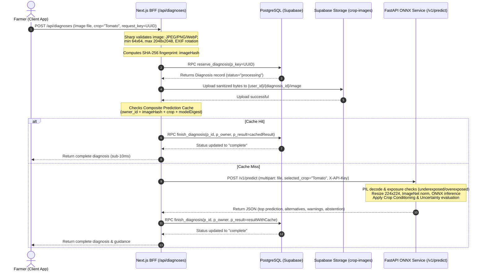
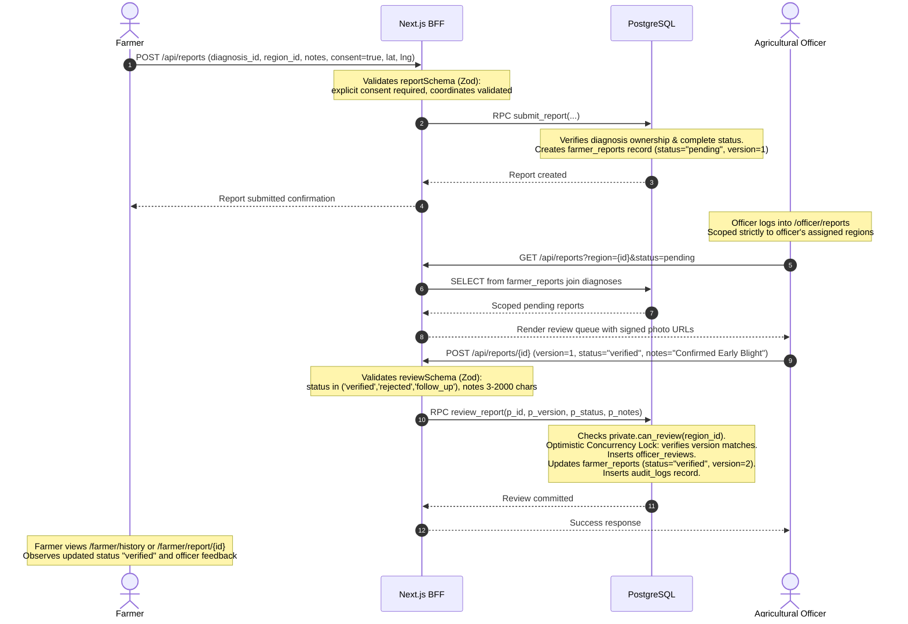

# PhytoX — Complete System Architecture Specification

**Document Identifier:** `03_SYSTEM_ARCHITECTURE.md`  
**Classification:** System Architecture & Data Flow Specification  
**Architecture Pattern:** Multi-Tier Architecture with Backend-for-Frontend (BFF) Pattern  
**Confidence Status:** VERIFIED FROM SOURCE IMPLEMENTATION  

---

## 1. High-Level Architectural Model

PhytoX adopts a decoupled, multi-tier cloud-and-edge architecture designed for security, low-latency execution, and operational fault isolation:

```
┌─────────────────────────────────────────────────────────────────────────────────┐
│                                CLIENT WORKSPACES                                │
├────────────────────────────────────────┬────────────────────────────────────────┤
│        FARMER PROGRESSIVE WEB APP      │       OFFICER COMMAND WORKSTATION      │
│   • Next.js 16 Client Components (PWA) │   • Next.js 16 Desktop Viewports       │
│   • Multi-lingual (EN, TE, HI)         │   • GIS Disease Maps (Leaflet)         │
│   • Camera & Photo File Preview        │   • Review Queue & Farmer Directory    │
│   • Capacitor Android Native Wrapper   │   • Spatial Outbreak Surveillance      │
└───────────────────┬────────────────────┴───────────────────┬────────────────────┘
                    │                                        │
                    ▼                                        ▼
┌─────────────────────────────────────────────────────────────────────────────────┐
│                      NEXT.JS BACKEND-FOR-FRONTEND (BFF)                         │
│                    (Vercel: https://phytox.vercel.app)                          │
├─────────────────────────────────────────────────────────────────────────────────┤
│   • Route Handlers (/api/diagnoses, /api/reports, /api/monitoring, /api/officer)│
│   • Sharp C++ Image Sanitation (Auto-rotate, size limits, EXIF stripping)       │
│   • Server-Side SHA-256 Cryptographic Fingerprinting & Prediction Caching       │
│   • Origin Validation & CSRF Protection Layer (lib/api/protection.ts)           │
│   • Cookie-Based Session Verification & Scoped Supabase SSR Client              │
└───────────────────┬────────────────────────────────────────┬────────────────────┘
                    │                                        │
                    ▼                                        ▼
┌──────────────────────────────────────┐  ┌───────────────────────────────────────┐
│       FASTAPI ONNX MICROSERVICE      │  │        SUPABASE CLOUD PLATFORM        │
│          (Render Container)          │  │     (AWS eu-central-1 / ap-south-1)   │
├──────────────────────────────────────┤  ├───────────────────────────────────────┤
│  • Asynchronous FastAPI 0.115 Engine │  │  • Supabase Auth (JWT & Role Claims)  │
│  • ONNX Runtime (CPU intra-op x2)    │  │  • PostgreSQL 15 Relational Database  │
│  • MobileNetV2 (supplied.onnx)       │  │    - 13 Tables with 100% RLS Coverage │
│  • Bilinear Resizing & Normalization │  │    - Security Definer Stored Procs    │
│  • Domain Foliar Crop Conditioning   │  │    - k-Anonymity Regional Aggregation │
│  • Luminance & Exposure Quality Guard│  │  • Private Storage (crop-images)      │
│  • Uncertainty Abstention Evaluator  │  │    - Signed Tokenized URLs (TTL 1 hr) │
└──────────────────────────────────────┘  └───────────────────────────────────────┘
```

---

## 2. Core Architectural Subsystems

### 2.1 The Backend-for-Frontend (BFF) Pattern
A foundational security decision in PhytoX is the strict prohibition of direct client-to-inference or client-to-database-service-role communication.
1. The untrusted client (browser or mobile webview) communicates exclusively with Next.js App Router Route Handlers over HTTPS.
2. The BFF authenticates the user via encrypted HTTP-only session cookies managed by `@supabase/ssr`.
3. The BFF performs compute-heavy image validation (Sharp) on server silicon before dispatching payloads, defending downstream microservices against decompression bombs and malformed requests.
4. The BFF holds the `INFERENCE_API_KEY` and the Supabase `SUPABASE_SERVICE_ROLE_KEY` securely in server environment memory.

### 2.2 Dual-Portal Role Isolation
The application cleanly bifurcates user experiences based on database-enforced roles (`role in ('farmer', 'officer', 'admin')`):
* **Farmer Workspace (`/farmer`):** Optimized for low-bandwidth mobile viewports. Farmers can only read and write their own diagnoses, crop plots, and observations.
* **Agricultural Officer Command Portal (`/officer`):** Desktop-oriented interface restricted to authenticated users with `role = 'officer'`. Access is further segmented by geographical jurisdiction (`officer_regions` junction table), preventing officers from viewing or modifying records outside their assigned districts.

---

## 3. End-to-End Data Flow: The Two-Phase Diagnosis Lifecycle

The primary diagnosis transaction is engineered as a two-phase commit pattern to guarantee idempotency and prevent orphaned storage files:



### Detailed Trace of Function Calls in Diagnosis:
1. `analyze(request)` in `apps/web/src/services/diagnosis.ts`:
   - Validates user context via `context()` (`apps/web/src/lib/server.ts`).
   - Reads multipart form: extracts `file`, validates `request_key` as UUID via Zod, reads `selected_crop`.
   - Sharp processing: limits input to 20 megapixels, verifies dimensions $\ge 64\times 64$, normalizes EXIF orientation, resizes within $2048\times 2048$, outputs JPEG quality 90.
   - Computes `imageHash = crypto.createHash('sha256').update(bytes).digest('hex')`.
2. `db.rpc('reserve_diagnosis', { p_key: key })`:
   - Executes stored procedure in `supabase/migrations/202610310001_initial.sql`.
   - Idempotency guard: if a record exists for `(owner_id, request_key)`, returns existing record. If status is already `'complete'`, returns immediately without re-running inference.
3. Storage upload:
   - Stores raw bytes in private bucket `crop-images` at path `${user.id}/${d.id}/image` using `trustedClient` (`apps/web/src/lib/supabase/trusted.ts`).
4. Prediction Cache Lookup:
   - Builds composite signature:
     $$\text{sig} = \text{JSON}(\text{owner\_id}, \text{image\_hash}, \text{selected\_crop}, \text{model\_digest}, \text{pre\_version}, \text{post\_version}, \text{params})$$
   - Computes `compositeCacheKey = sha256(sig)`.
   - Queries `diagnoses` where `owner_id = user.id` and `result @> { cache_key: compositeCacheKey }`.
   - If hit: calls `finish_diagnosis` with `cached: true` and returns without invoking ONNX.
5. Inference Dispatch:
   - Calls `${INFERENCE_URL}/v1/predict` with header `X-API-Key: process.env.INFERENCE_API_KEY`.
   - On response: validates JSON payload against `resultSchema` (`apps/web/src/lib/contracts.ts`).
   - Calls `finish_diagnosis(p_id, p_owner, p_result)` via service role.
6. Error Rollback:
   - If inference fails or times out: catches exception, calls `finish_diagnosis(p_id, p_owner, null, p_error)` setting `status = 'failed'`, removes uploaded storage image, and rethrows user-friendly `ApiError`.

---

## 4. Farmer-to-Officer Reporting & Verification Lifecycle



---

## 5. Longitudinal Crop Surveillance Architecture

The continuous surveillance subsystem tracks crop health over time across defined geographic farm plots:

```
┌────────────────────────────────────────────────────────┐
│               PLOT REGISTRATION WORKFLOW               │
│  Farmer registers plot: Name, Crop, Planting Date, Area│
│  Database generates: monitored_plots record            │
│  Automatic trigger creates: monitoring_schedules       │
│  (Cadence: twice_weekly, Days: Mon & Thu, NextDueCalc) │
└──────────────────────────┬─────────────────────────────┘
                           │
                           ▼
┌────────────────────────────────────────────────────────┐
│            PERIODIC OBSERVATION SUBMISSION             │
│  Farmer uploads periodic leaf photo on scheduled day   │
│  Captured in: crop_observations table                  │
│  Dynamic algorithm updates next_due_date on schedule   │
└──────────────────────────┬─────────────────────────────┘
                           │
                           ▼
┌────────────────────────────────────────────────────────┐
│           DETERMINISTIC EARLY-WARNING EVALUATOR        │
│  services/monitoring.ts evaluates incoming observation │
├────────────────────────────────────────────────────────┤
│  RULE 1: Recurrent Disease                             │
│  Condition: Sequential observations detect same disease│
│  Action: Trigger 'recurrent_disease' signal (High)     │
├────────────────────────────────────────────────────────┤
│  RULE 2: Regional Cluster                              │
│  Condition: >= 3 observations in region in 7 days with │
│             identical pathology                        │
│  Action: Trigger 'regional_cluster' signal (High)      │
└──────────────────────────┬─────────────────────────────┘
                           │
                           ▼
┌────────────────────────────────────────────────────────┐
│             OFFICER INTERVENTION & ADVISORY            │
│  Officer inspects monitoring_signals queue             │
│  Dispatches targeted monitoring_advisories to farmer   │
│  Signal status transitions to 'advisory_issued'        │
└────────────────────────────────────────────────────────┘
```

---

## 6. Security Architecture & Boundary Invariants

### 6.1 Authentication Architecture
* **Identity Provider:** Supabase Auth using industry-standard JSON Web Tokens (JWT).
* **Cookie-Based SSR Sessions:** Web tokens are stored in encrypted `HttpOnly`, `SameSite=Lax`, `Secure` cookies.
* **Role Verification:** User roles (`farmer`, `officer`, `admin`) are stored in `public.user_profiles` linked directly to `auth.users(id)`. Client role claims are never trusted; every server Route Handler and database stored procedure independently re-evaluates role permissions against the database.

### 6.2 Origin & CSRF Protection
Implemented in `apps/web/src/lib/api/protection.ts`:
* Mutation requests (POST, PUT, PATCH, DELETE) require strict Origin and Referer validation against the allowed hostnames (`phytox.vercel.app`, `localhost:3000`, `127.0.0.1:3000`).
* Cross-origin form submissions or spoofed headers are rejected with HTTP 403 before processing.

### 6.3 Database Security: 100% Row Level Security (RLS)
PostgreSQL Row Level Security ensures that even if client code is manipulated, the database engine enforces isolation:
1. `public.diagnoses`: Read policy `private.can_read_diagnosis(id)` permits access only to the owning farmer, or an assigned officer if the diagnosis has been voluntarily attached to a submitted report.
2. `public.farmer_reports`: Read policy permits access to the owner (`owner_id = auth.uid()`) or an officer assigned to that region via `private.can_review(region_id)`.
3. `public.user_profiles`: Farmers can view only their own profile. Officers can view farmer profiles strictly within their assigned administrative districts (`region_id in (select region_id from officer_regions where officer_id = auth.uid())`).
4. `private` Schema Isolation: Security helper functions (`is_admin`, `can_review`, `can_read_diagnosis`) are compiled inside a separate `private` schema. Public and anonymous users have execute permissions explicitly revoked.

### 6.4 Storage Security
* Raw images are stored in a private Supabase Storage bucket (`crop-images`).
* Storage upload policy enforces path ownership: `(storage.foldername(name))[1] = auth.uid()::text`. A user cannot write files into another user's folder.
* Read access requires time-limited cryptographic signed URLs (TTL: 3600 seconds) generated by server-side RPCs after verifying authorization.

### 6.5 Differential Privacy in Regional Insights
The SQL function `public.regional_insights(p_region uuid)` implements strict k-anonymity:
```sql
select r.crop, r.disease, count(*)
from public.farmer_reports r
where auth.uid() is not null
  and r.region_id = p_region
  and r.status = 'verified'
  and r.created_at >= now() - interval '30 days'
group by r.crop, r.disease
having count(distinct r.owner_id) >= 3;
```
If fewer than 3 distinct farmers have reported a condition in a region, the aggregate record is completely withheld, preventing adversaries or malicious actors from de-anonymizing or tracking individual smallholders.

---

## 7. Deployment & Infrastructure Architecture

```
                                  INTERNET
                                     │
                    ┌────────────────┴────────────────┐
                    │                                 │
           (Browser / Mobile PWA)        (Native Android APK)
                    │                                 │
                    ▼                                 ▼
             Vercel Edge Network (DNS, SSL, Edge Caching)
                    │
                    ▼
          Next.js 16 Web Application & BFF Serverless Runtime
          (https://phytox.vercel.app)
                    │
        ┌───────────┴────────────────────────┐
        │ Internal HTTPS                     │ Internal HTTPS
        │ (X-API-Key: HMAC)                  │ (Supabase Service Key)
        ▼                                    ▼
   Render Container Cloud             Supabase Managed Cloud
   • Python 3.11 Docker Container     • PostgreSQL 15 Instance
   • Uvicorn ASGI Server              • Supabase Auth Engine
   • FastAPI REST Microservice        • Supabase S3-Compatible Storage
   • ONNX Runtime CPU Engine
   • MobileNetV2 (supplied.onnx)
```

### Cold-Start Behavior & Resilience:
* The ML microservice on Render enters a low-power idle sleep after 15 minutes of inactivity.
* When a farmer initiates a diagnosis while the service is waking, the BFF detects the cold state via `GET /ready` or request timeouts, and returns a graceful status (`status: 503`, code: `'model_connecting'`).
* The UI displays an informative connecting banner ("Crop analysis service is connecting, please wait…"). The application **never fabricates placeholder or mock predictions** during service cold starts.
