# PhytoX — Complete System Diagrams Specification

**Document Identifier:** `16_SYSTEM_DIAGRAMS.md`  
**Classification:** Visual Systems Engineering & Architectural Schematics  
**Format:** Validated GitHub-Flavored Mermaid Diagram Specifications  
**Confidence Status:** VERIFIED FROM CODEBASE WORKFLOWS & SCHEMAS  

---

## 1. Overall System Architecture

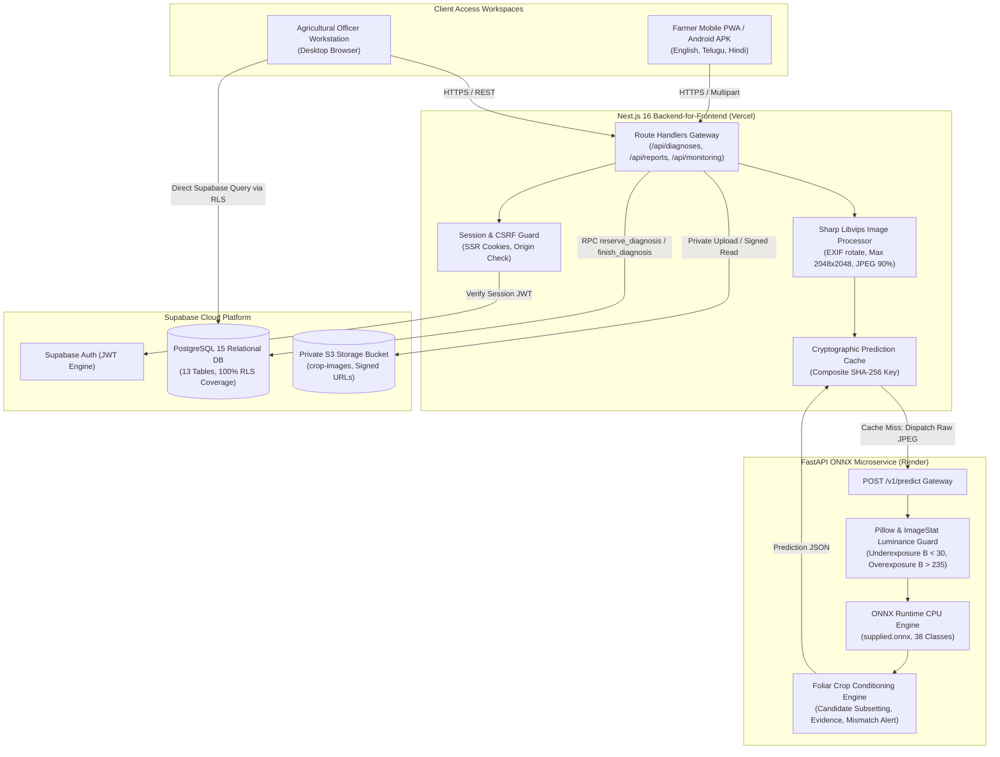

---

## 2. Use-Case Diagram

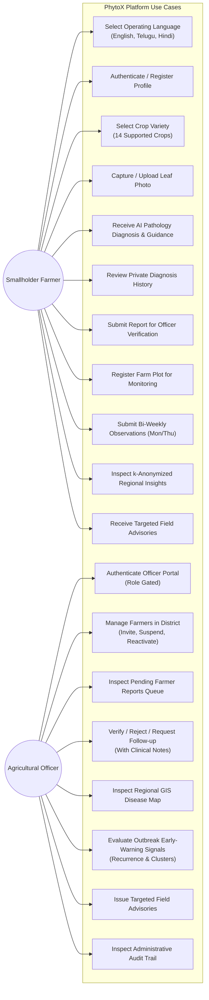

---

## 3. Context-Level Data Flow Diagram (DFD Level 0)

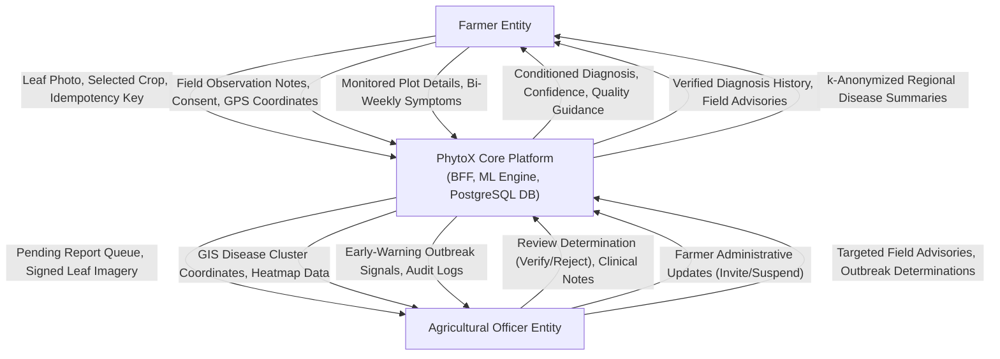

---

## 4. DFD Level 1: Subsystem Deconstruction

```mermaid
flowchart TD
    subgraph Processes["PhytoX Core Processes"]
        P1["1.0 Image Validation & Sanitation"]
        P2["2.0 Two-Phase Diagnosis & Caching"]
        P3["3.0 Crop-Conditioned Inference Engine"]
        P4["4.0 Report Escalation & Verification"]
        P5["5.0 Longitudinal Plot Surveillance"]
        P6["6.0 Spatial & Temporal Signal Evaluator"]
        P7["7.0 Privacy-Preserving Regional Aggregator"]
    end

    subgraph DataStores["Data Stores"]
        D1[("D1: Private Storage (crop-images)")]
        D2[("D2: Diagnoses & Cache Store")]
        D3[("D3: Farmer Reports & Reviews")]
        D4[("D4: Monitored Plots & Schedules")]
        D5[("D5: Observations & Signals")]
        D6[("D6: User Profiles & Audit Logs")]
    end

    Farmer["Farmer"] -->|Uploads Leaf Photo| P1
    P1 -->|Sanitized JPEG Bytes| P2
    P2 -->|Save Raw Image| D1
    P2 -->|Check / Commit Result| D2
    P2 -->|Forward Bytes & Selected Crop| P3
    P3 -->|Conditioned Predictions| P2
    P2 -->|Render Diagnosis Result| Farmer

    Farmer -->|Submit Observation Report| P4
    P4 -->|Insert Report| D3
    Officer["Officer"] -->|Fetch Review Queue| P4
    P4 -->|Commit Review & Audit| D3
    P4 -->|Log Audit Action| D6

    Farmer -->|Register Plot & Observations| P5
    P5 -->|Update Plots & Due Dates| D4
    P5 -->|Insert Observation Photo| D5
    P5 -->|Trigger Heuristic Evaluation| P6
    P6 -->|Write Recurrence & Cluster Signals| D5
    Officer -->|Inspect Signals & Issue Advisory| P6

    D3 -->|Verified Reports (>= 3 Contributors)| P7
    P7 -->|k-Anonymized Insights| Farmer
```

---

## 5. Farmer Diagnosis Flowchart

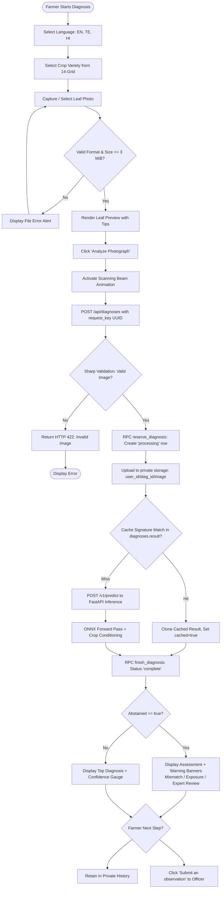

---

## 6. MobileNetV2 Inference Pipeline

```mermaid
flowchart TD
    InputRaw["Raw Leaf Image Bytes (JPEG/PNG/WebP)"] --> PILDecode["Pillow Image Open & EXIF Transpose"]
    PILDecode --> DecompressGuard{"Pixels <= 20 Million?"}
    DecompressGuard -- Exceeded --> ThrowBomb["Raise DecompressionBombError"]
    DecompressGuard -- Safe --> MinDim{"Min(Width, Height) >= 64px?"}
    MinDim -- No --> ThrowDim["Raise InvalidImage (<64px)"]
    MinDim -- Yes --> QualityCheck["Compute Mean Grayscale Luminance B"]

    QualityCheck --> CheckUnder{"B < 30?"}
    CheckUnder -- Yes --> FlagUnder["Append 'underexposed' warning"]
    CheckUnder -- No --> CheckOver{"B > 235?"}
    CheckOver -- Yes --> FlagOver["Append 'overexposed' warning"]
    CheckOver -- No --> Resize["Bilinear Resize to 224x224 pixels"]

    FlagUnder --> Resize
    FlagOver --> Resize
    Resize --> Scale["Scale to [0.0, 1.0]: Pixels / 255.0"]
    Scale --> Normalize["ImageNet Normalize:\n(x - [0.485, 0.456, 0.406]) / [0.229, 0.224, 0.225]"]
    Normalize --> Transpose["Transpose HWC to NCHW Tensor [1, 3, 224, 224]"]

    Transpose --> ONNXSession["ONNX Runtime Forward Pass\n(CPU Execution Provider, 2 Threads)"]
    ONNXSession --> Logits["Raw Logits Vector z in R^38"]
    Logits --> StableSoftmax["Numerically Stable Softmax:\nP_i = exp(z_i - max(z)) / sum(exp)"]

    StableSoftmax --> GlobalPeak["Extract Detected Visual Crop: C_det = Crop(argmax P)"]
    GlobalPeak --> HasSelectedCrop{"Did Farmer Select Crop C_sel?"}

    HasSelectedCrop -- Yes --> SubsetClasses["Filter Indices I_crop where Crop == C_sel"]
    SubsetClasses --> CalcEvidence["Compute Crop Evidence: E_crop = sum(P_i) for i in I_crop"]
    CalcEvidence --> CheckMismatch{"C_det != C_sel AND E_crop < 0.25?"}
    CheckMismatch -- Yes --> FlagMismatch["Set crop_mismatch_warning = true\nuncertain = true"]
    CheckMismatch -- No --> Renormalize["Renormalize: P(d_i | C_sel) = P_i / E_crop"]
    FlagMismatch --> Renormalize

    Renormalize --> TopPred["Top-1 Conditioned Prediction: i* = argmax P(d_i | C_sel)"]
    TopPred --> CalcMargin["Margin Delta = Top1_Conf - Top2_Conf"]
    CalcMargin --> UncertaintyCheck{"Top1_Conf < 0.70 OR Delta < 0.15?"}
    UncertaintyCheck -- Yes --> SetUncertain["Set uncertain = true"]
    UncertaintyCheck -- No --> SetAbstained["abstained = uncertain OR quality_warnings OR mismatch"]
    SetUncertain --> SetAbstained

    HasSelectedCrop -- No --> GlobalPred["Top-1 Global Prediction\nTop1_Conf = max(P)"]
    GlobalPred --> SetAbstained

    SetAbstained --> ReturnResponse["Return PredictionResponse JSON"]
```

---

## 7. Authentication & Role-Based Authorization Workflow

```mermaid
flowchart TD
    User([User Attempts Access]) --> CheckCookie{Encrypted Session Cookie Present?}
    CheckCookie -- No --> RedirectLogin[Redirect to /auth/login]
    
    CheckCookie -- Yes --> DecodeJWT[Supabase Auth Decodes JWT & auth.uid]
    DecodeJWT --> FetchProfile[Query public.user_profiles where id = auth.uid]
    
    FetchProfile --> RouteTarget{Target Route?}
    
    RouteTarget -- "/farmer/*" --> CheckFarmer{role in ('farmer', 'admin')?}
    CheckFarmer -- Yes --> AllowFarmer[Allow Access to Farmer PWA]
    CheckFarmer -- No --> DenyFarmer[Redirect to /officer]

    RouteTarget -- "/officer/*" --> CheckOfficer{role in ('officer', 'admin')?}
    CheckOfficer -- Yes --> FetchJurisdiction[Query public.officer_regions where officer_id = auth.uid]
    CheckOfficer -- No --> DenyOfficer[Return HTTP 403 Forbidden / Redirect to /farmer]
    
    FetchJurisdiction --> BindScope[Bind Regional Scope: region_id in (Officer Regions)]
    BindScope --> AllowOfficer[Allow Access to Officer Command Workstation]
```

---

## 8. Farmer-to-Officer Reporting Sequence Diagram

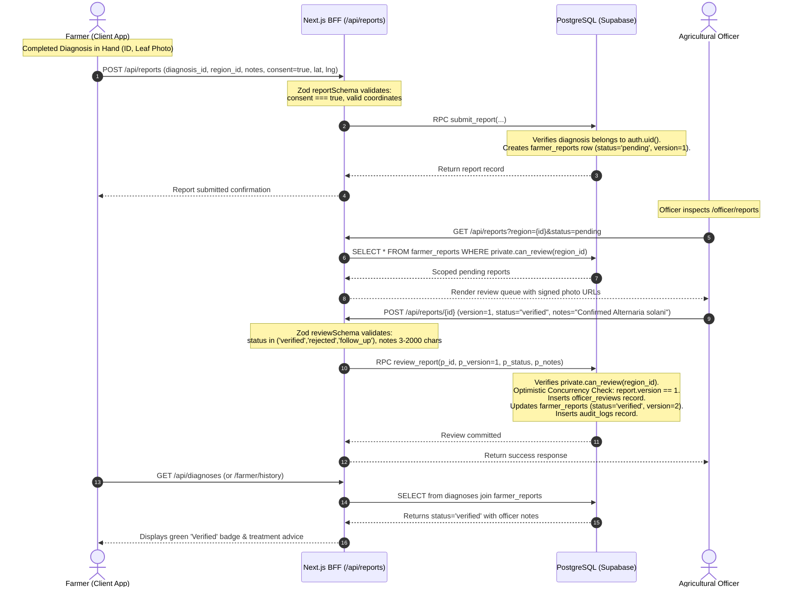

---

## 9. Crop Monitoring & Longitudinal Surveillance Workflow

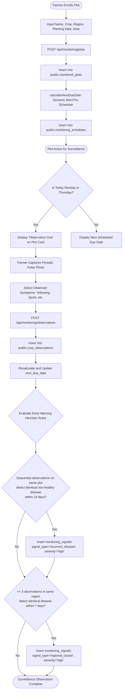

---

## 10. Regional Outbreak Warning & Advisory Workflow

```mermaid
flowchart TD
    SignalGenerated[monitoring_signals Generated by System] --> OfficerQueue[Surfaces in Officer Queue: /officer/surveillance]
    OfficerQueue --> OfficerInspect[Officer Inspects Spatial Distribution & Leaf Photos]
    
    OfficerInspect --> Determination{Officer Action?}
    
    Determination -- Dismiss --> DismissSignal[UPDATE monitoring_signals SET status='dismissed']
    DismissSignal --> AuditDismiss[Log to audit_logs]
    
    Determination -- Formulate Advisory --> OpenAdvisoryModal[Click 'Issue Advisory']
    OpenAdvisoryModal --> WriteAdvisory[Input Advisory Text: 5-3000 chars\nStructured Treatment Steps JSON]
    WriteAdvisory --> SubmitAdvisory[POST /api/officer/monitoring]
    
    SubmitAdvisory --> InsertAdvisory[INSERT INTO public.monitoring_advisories\n(farmer_id, plot_id, advisory_text, recommendations)]
    InsertAdvisory --> UpdateSignal[UPDATE monitoring_signals SET status='advisory_issued',\nreviewed_by=auth.uid, reviewed_at=now()]
    UpdateSignal --> AuditAdvisory[Log to audit_logs]
    
    AuditAdvisory --> FarmerInbox[Advisory Surfaces in Farmer Monitoring View]
    FarmerInbox --> FarmerAction([Farmer Applies Recommended Treatment])
```

---

## 11. Database Entity-Relationship (ER) Diagram

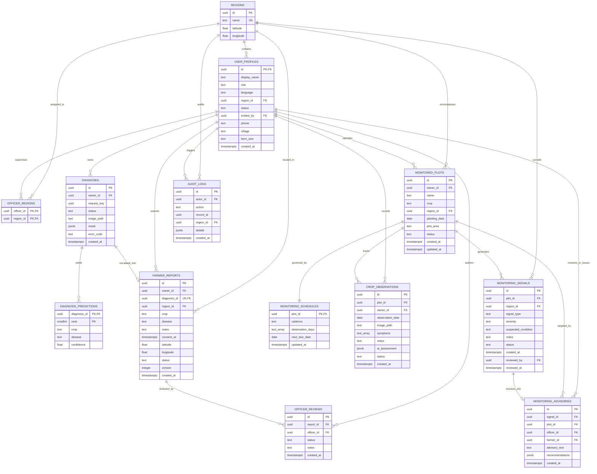

---

## 12. Prediction Caching & Deduplication Architecture

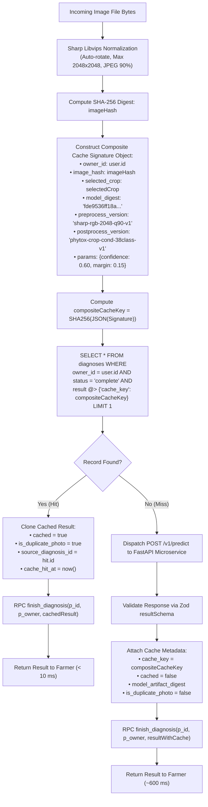

---

## 13. Deployment Infrastructure Topology

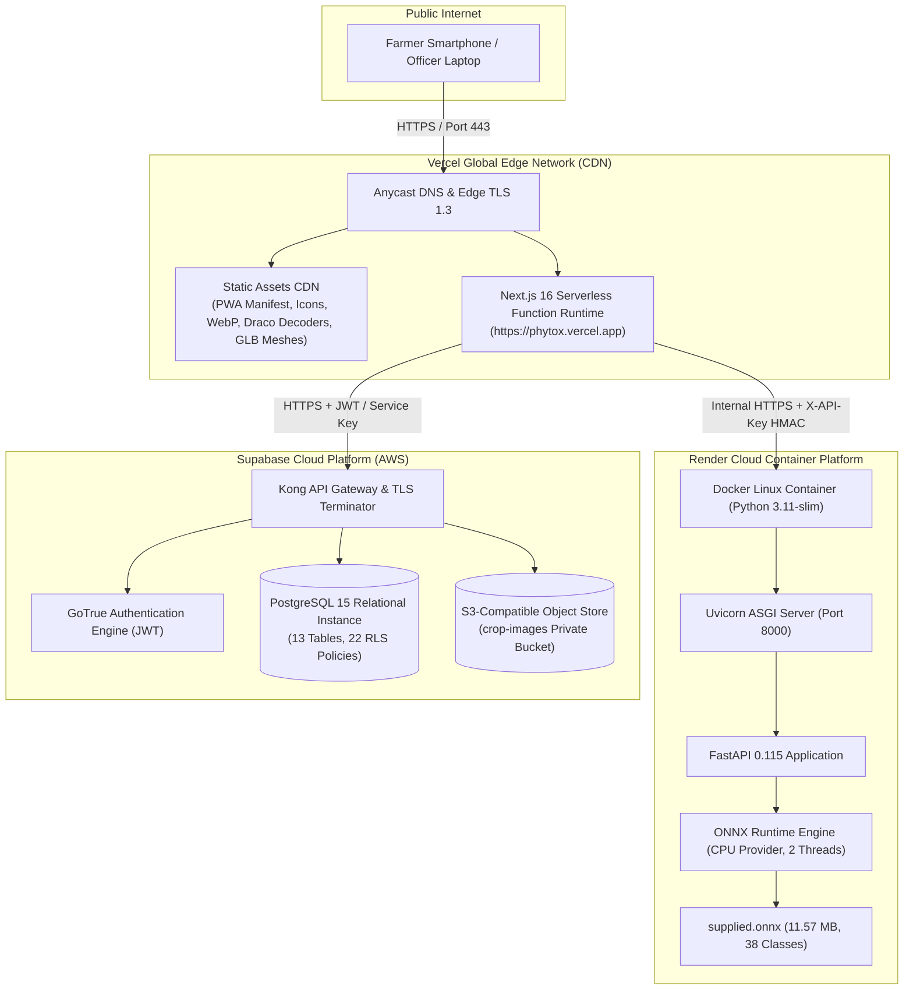

---

## 14. Android / Capacitor Mobile Container Architecture

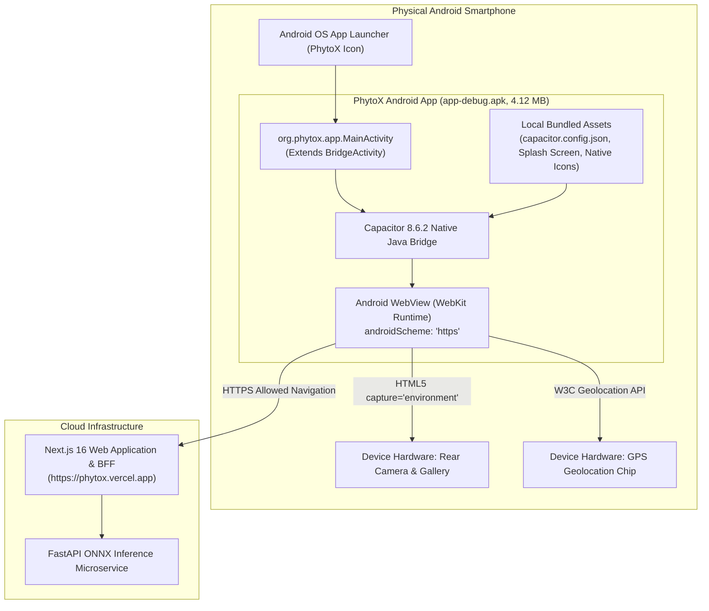
